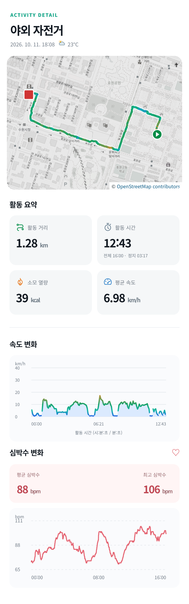
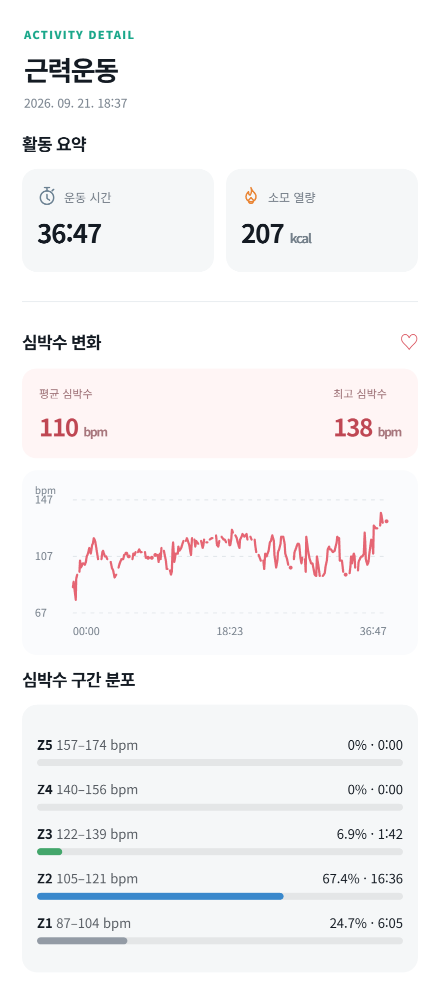

# Kilometrika KR

운동 파일을 내 서버에 모아 보고, 운동 결과를 이미지로 저장하기 위한 개인용 운동 기록 사이트입니다.

**Google Health(구글 헬스)에서 내보낸 TCX 운동 파일을 기준으로 만들고 다듬었습니다.** 다른 앱이나 기기의 TCX·GPX도 불러올 수 있지만, 파일에 포함된 항목과 형식에 따라 표시 결과가 달라질 수 있습니다.

## 왜 만들었나요?

운동 앱에서 내보낸 파일을 직접 보관하면서, 내가 보고 싶은 형태로 운동 결과를 정리하고 싶었습니다. 거리와 시간만 확인하는 데서 끝나지 않고, 이동 경로와 심박수 변화를 한 화면에 보고 결과를 이미지로 남기는 것이 첫 번째 목표였습니다.

그래서 [Kilometrika](https://github.com/m1ty/kilometrika)를 바탕으로 한국어 화면을 만들고, 야외 자전거와 근력운동에 맞춰 표시 항목을 다듬었습니다. 개인이 Docker로 실행하고 자신의 운동 파일을 직접 올려 사용하는 방식입니다.


## 운동 결과 이미지

실제 PNG 저장 결과입니다. 이미지를 누르면 원본 크기로 볼 수 있습니다.

<table>
  <tr>
    <th>야외 자전거</th>
    <th>근력운동</th>
  </tr>
  <tr>
    <td valign="top"><a href="docs/images/cycling-result.png"></a></td>
    <td valign="top"><a href="docs/images/strength-result.png"></a></td>
  </tr>
</table>

## 무엇을 할 수 있나요?

- **운동 기록 모아 보기:** TCX·GPX 파일을 올리고 날짜별로 찾아볼 수 있습니다. 목록에는 종목에 맞춰 거리나 소모 열량, 운동 시간을 표시합니다.
- **야외 자전거 결과 보기:** 지도 위 이동 경로, 속도에 따른 경로 색상, 이동 시간, 평균 이동 속도, 심박수·고도 변화를 확인합니다.
- **근력운동 결과 보기:** 운동 시간과 소모 열량, 평균·최고 심박수, 심박수 변화와 구간별 시간을 확인합니다.
- **결과 이미지 저장:** 상세 화면의 저장 버튼으로 운동 결과를 PNG 이미지로 남길 수 있습니다.
- **당시 날씨 확인:** GPS가 있는 기록은 운동 시작 위치와 시각을 기준으로 날씨와 기온을 표시합니다.

화면에 표시할 값은 운동 파일에 들어 있는 정보에 따라 달라집니다. 없는 심박수나 GPS를 임의로 만들어 넣지는 않습니다. 일부 거리·속도는 GPS로 계산하고, 날씨는 외부 기상 자료를 사용합니다.

## 어떻게 사용하나요?

1. 자신의 PC나 홈서버에서 Docker로 실행합니다.
2. 운동 앱이나 기기에서 내보낸 TCX·GPX 파일을 화면에 끌어다 놓습니다.
3. 왼쪽 목록에서 기록을 선택해 결과를 확인합니다.
4. 근력운동이 ‘기타’로 들어오면 **운동 관리 · 기존 기능 → 근력운동**을 선택합니다.
5. 보관하거나 공유하고 싶은 결과는 상세 화면의 버튼으로 이미지로 저장합니다.

‘기타’라는 파일 정보만으로 근력운동을 자동 구분하지는 않습니다. 종목을 직접 선택하면 해당 운동에 맞는 화면으로 표시됩니다.

## 어디에 저장되고, 무엇과 연결되나요?

운동 파일과 기록은 이 프로그램을 실행하는 **내 서버의 저장 공간**에 보관됩니다. 기본 사용에는 지도와 날씨를 제외한 별도 서비스 계정 연결이 필요하지 않습니다. 운동 서비스 계정에서 기록을 자동으로 가져오는 방식이 아니라, 사용자가 파일을 직접 올리는 방식입니다.

지도는 외부 지도 서비스를 이용하고, 날씨를 조회할 때는 운동 시작 위치와 날짜를 Open-Meteo에 전달합니다. 날씨는 해당 지역의 추정 정보이며, 기기에서 직접 측정한 온도는 아닙니다.

원본 프로젝트의 Home Assistant 연동 같은 선택 기능은 코드에 남아 있지만 기본적으로 꺼져 있고, 일반적인 사용에는 설정할 필요가 없습니다.

## 빠르게 실행하기

Docker와 Docker Compose가 설치된 환경에서 다음 명령을 실행합니다.

```bash
git clone https://github.com/lux2222/kilometrika-kr.git
cd kilometrika-kr
docker compose -p kilometrika-fork up -d --build
```

같은 컴퓨터의 브라우저에서 **http://127.0.0.1:8000**으로 접속합니다. 기본 설정은 실행한 컴퓨터에서만 접속하도록 되어 있습니다. 다른 기기에서 접속하려면 접속 주소 설정을 바꿔야 합니다. 현재 별도 로그인 기능이 없으므로 공용 인터넷에 그대로 공개하지 마세요.

종료하거나 다시 실행할 때는 다음 명령을 사용합니다. 종료해도 운동 기록은 유지됩니다.

```bash
docker compose -p kilometrika-fork stop
docker compose -p kilometrika-fork start
```

Docker가 관리하는 별도 데이터 공간에 기록이 저장됩니다. **데이터 공간을 삭제하는 `docker compose down -v`는 사용하지 마세요.**

포트 변경, 데이터 위치, 백업 명령과 세부 설정은 [설치·백업 안내](docs/setup-and-notes.ko.md)를 참고하세요.

## 사용 전에 알아둘 점

- 심박수 구간은 현재 개인용으로 지정한 값입니다. 자신의 기준에 맞추려면 `app/hr_zones.py`를 수정하고 다시 빌드해야 합니다. 아직 화면에서 바꾸는 설정 기능은 없습니다.
- 날짜 표시는 현재 한국 시간 기준입니다.
- GPS가 없는 운동에는 지도를 표시하지 않습니다. 원본 데이터가 없거나 읽을 수 없으면 관련 분석도 표시하지 못할 수 있습니다.
- GitHub 업로드용 사본은 Docker 빌드와 기본 실행을 확인했습니다. 모든 기기·운동 파일에서의 동작을 검증한 것은 아닙니다.

## 앞으로 해보고 싶은 것

기록을 보기 좋게 정리하고 이미지로 남기는 기능을 먼저 다듬고 있습니다.

이후에는 쌓인 운동 기록을 바탕으로 운동 패턴을 돌아보고, 다음 운동에 참고할 조언을 제공하는 **운동 코치 기능**을 추가하고 싶습니다. 아직 구현된 기능은 아닙니다.

## 원본 프로젝트와 라이선스

이 프로젝트는 [m1ty/kilometrika](https://github.com/m1ty/kilometrika)를 바탕으로 만든 한국어 커스텀 버전입니다. 원본 개발자에게 감사드립니다.

원본의 Git 이력과 MIT 라이선스, 저작권 표시를 유지합니다. 사용 조건은 [LICENSE](LICENSE)를 확인하세요. 함께 사용하는 라이브러리의 라이선스도 저장소에 포함되어 있습니다.

원본에서 가져온 문서 이미지는 이 버전의 실제 화면과 다를 수 있습니다.
